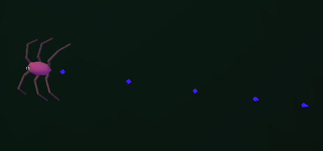

After having dealt with the leg issues and reworking them properly, I decided to pursue the next goal, which (in my head at least) was the pheromones. I wanted to get a framework for them now, to have a new and interesting thing to come back to later and give it some proper meaning.

## A 'scent' is a point located in a triangle

The idea was to give the scent some value, not just have it as a redundant asset to make things prettier, I want scents to be valuable to spiders later on in the sim. To do that, I decided to opt for a barycentric triangle design, where a **scent** is represented by its respective color, which is made up by making the normalized RGB values add up to 1, forcing the shades (and the scents) into this triangular plane of combinations. I liked this idea, because it would allow me to map out the different areas of the triangle as certain scents, and have them represented easily in a unique way.

<span class="margin-note">When I first saw the scents appear behind the spiders, they... Well... Looked like poo to me, but hey, poo or not it was working and that's what mattered to me the most!</span>



<details>
<summary><strong>For the code-curious</strong> - click to expand</summary>

Every founder rolls three random numbers, one per color channel, and `NormalizeScent` divides each by the total so they always add up to 1. That is the triangle, with a fixed sum only two of the three values are free, so a scent is a point on a flat surface instead of a spot inside a cube. The `-Log` on each roll is there so founders spread evenly across the triangle, because normalizing plain random numbers crowds everything toward the middle.

```csharp
genome.ScentR = -Mathf.Log(Mathf.Max(rng.Randf(), 0.0001f));
genome.ScentG = -Mathf.Log(Mathf.Max(rng.Randf(), 0.0001f));
genome.ScentB = -Mathf.Log(Mathf.Max(rng.Randf(), 0.0001f));
genome.NormalizeScent();
```

```csharp
public void NormalizeScent()
{
    float sum = ScentR + ScentG + ScentB;
    if (sum < 0.0001f)
    {
        ScentR = ScentG = ScentB = 1f / 3f;
        return;
    }
    ScentR /= sum;
    ScentG /= sum;
    ScentB /= sum;
}
```

A child copies all three channels from one parent, picked with basically a coin flip, so its scent is always a point someone already had. The same function averages `SensorRadius`, which is fine for a plain number, but averaging points in the triangle would drag every lineage toward the middle.

```csharp
var scentSource = rng.Randf() < 0.5f ? a : b;
child.ScentR = scentSource.ScentR;
child.ScentG = scentSource.ScentG;
child.ScentB = scentSource.ScentB;
```

</details>

The markers are tiny pyramids standing on the ground instead of flat decals. A flat shape lying on a curved planet can turn edge-on to the camera and vanish, which is easy to run into with a free camera (something I am looking forward to adding at some point). A pyramid reads from every angle, so the trails stay visible wherever you see them from.

## Smelling without seeing

My idea regarding pheromone detection would be giving the spiders a sense of *smell*, or simply speaking, a radius in which they could sense the pheromones, added a few nodes to have them react to pheromones, added the ability for those things to evolve through generations and here we are. This also means that I can potentially evolve spiders that are mostly blind, yet still persist and mate with others by simply having a good sense of smell instead of the eyesight.

Talking about the inheritance of the pheromone *shade*, I decided to now have the simulation pick one of the parents and have their offspring inherit that smell, instead of blending both parents' shades, which would often lead to this grayed out and dull shade every spider would have.

## The bug where every spider was a clone

With the first iteration of the scent spawning, I've noticed that every spider produced the same scent, at first I thought it was simply a misplaced line of code on my side, or some other easy to fix error, so I started digging.

<span class="margin-note">We are getting there, I said to myself, the wheels are mismatched, but we are rolling forwards.</span>

As I thought, the issue was that the first spider was fresh, and the remaining spiders from the starting population were simply slightly mutated clones of the original one, and with that it just so happened that they all had a very similar scent shade spread among them.

<details>
<summary><strong>For the code-curious</strong> - click to expand</summary>

`FindFittestSpider` loops over the living spiders and keeps whichever one has the highest fitness so far. The check is a strict `>`, so a tie goes to whoever was looked at first. When the starting population spawns nobody has earned anything yet, so 'fittest' quietly meant 'first in the list', and every later starting spider becomes a slightly mutated copy of the first spider.

```csharp
private SpiderMovement FindFittestSpider()
{
    SpiderMovement best = null;
    float bestFitness = -1f;

    foreach (var s in _activeSpiders)
    {
        var e = s.GetNode<SpiderEnergy>("Energy");
        if (e.Fitness > bestFitness)
        {
            bestFitness = e.Fitness;
            best = s;
        }
    }

    return best;
}
```

The fix was to stop asking. `SpawnSpider(true)` skips the parent lookup and builds each starting spider from its own fresh random founder, so the population starts with real variety instead of being exact copies of each other.

```csharp
for (int i = 0; i < SpawnCount; i++)
    SpawnSpider(true);
```

```csharp
var bestParent = forceFounder ? null : FindFittestSpider();
```

</details>

What bothers me is that I had already decided the starting spiders were fully random. I never checked, it just sounded right, and that assumption sat in front of the real bug the whole time. Next time something looks too uniform, I'm checking the starting population first.

## A trait only evolves if it pays

Evolution only keeps a trait that pays, and right now smelling something earns a spider nothing. Food is the first thing worth smelling, so it got a scent in the same three channels, with no new brain inputs. There is also a side effect I kept on purpose. Food and spiders only differ by where their scent sits in the triangle, so a spider whose scent lands close to food's point smells like food. That is the groundwork for mimicry later, a spider luring others in by smelling like a meal. Nothing like it has evolved yet, but now it is at least possible.

## Where this honestly stands

The markers, the per-spider scents and the food scent all work and are visible in the sim right now. What I haven't seen is any spider actually using them yet. The founder brain (the one which all first generation spiders spawn with) doesn't react to scents whatsoever, meaning that any use of them has to evolve on its own through generations. This whole ordeal is simply an experiment I will keep working on until I see some results.

## What's next

For the future, regarding the scents, I'd like to add some jitter to the smell, meaning spiders will behave more dog-like when looking for the source of the smell, not go directly to it in a straight line. Additionally I'd like to add conditional emission, where spiders wouldn't constantly emit the pheromones. Further down the line, I want to see whether something like food mimicry can show up on its own, now that spiders and food share the same scent space. Besides that I also have a heap of stuff to do for uni so updates might be a bit delayed, like it was with this post.